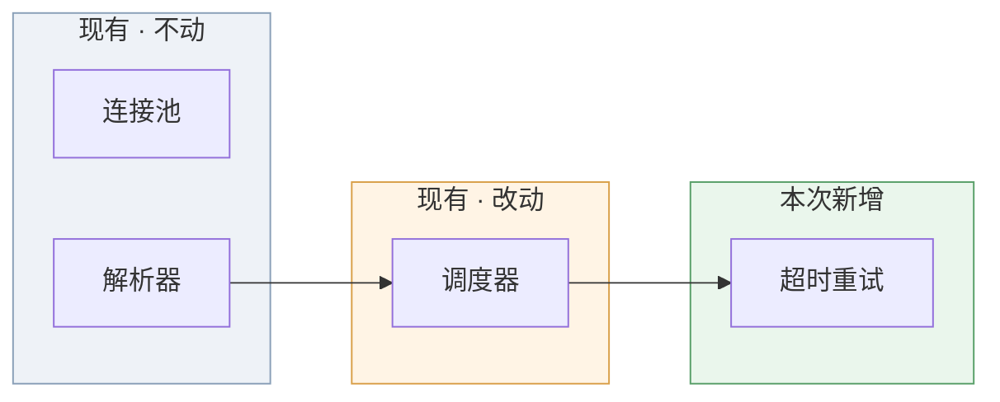
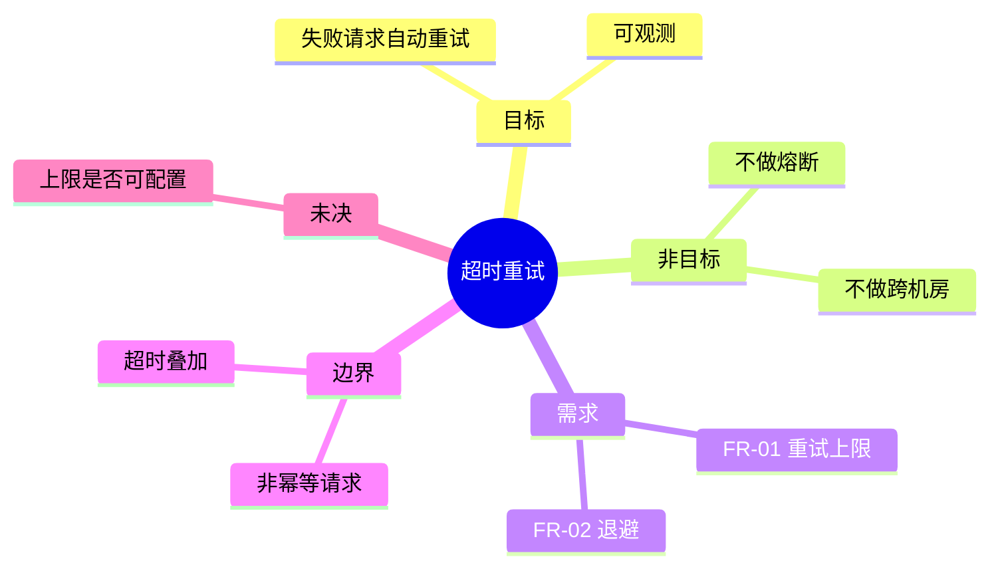
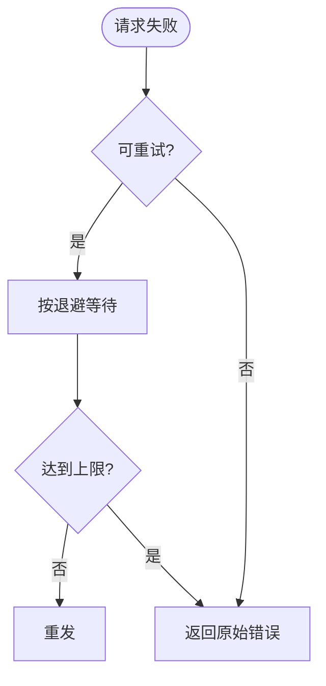
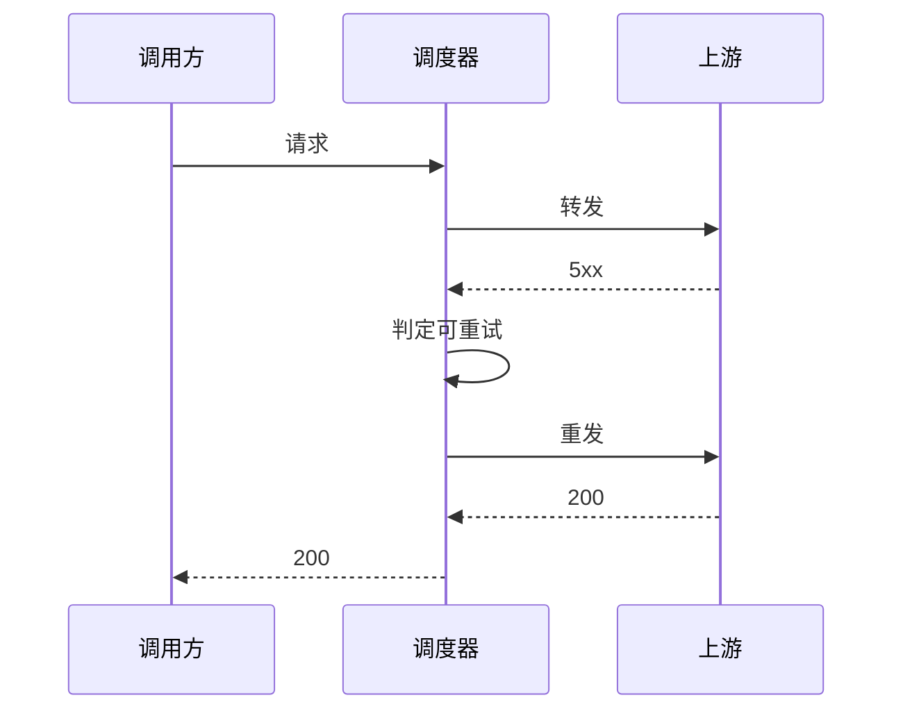
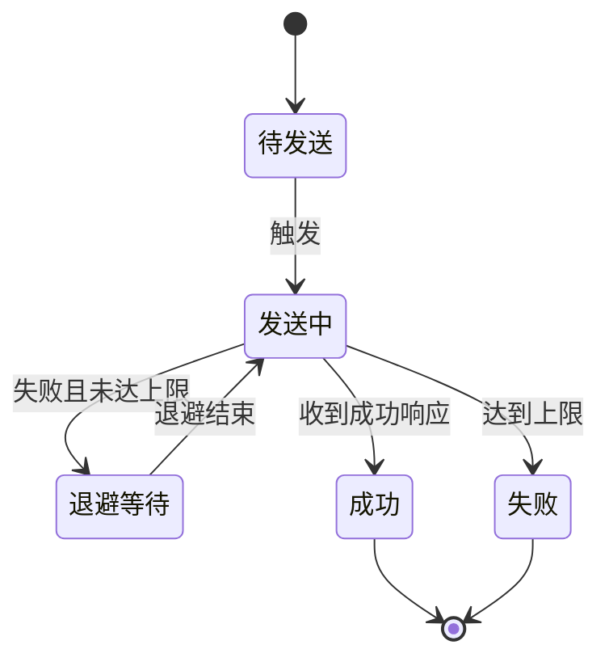

# 文档模板

按此骨架产出。空节可省，节序不要变——前四节是扫读层，人和 agent 读到这里就该建立全貌。

```markdown
# <功能名>

## 1. 一句话摘要
<本功能是什么，一句话。不写技术，不写方案。>

## 2. 全景区
<现有系统的相关部分怎么工作、本功能接在哪个现有模块上。图见下方片段。>

- 新增：<...>
- 改动：<...>
- 明确不动：<...>
- 影响面：<会变的行为 / 不会变的行为>
- 必须保持不变的既有行为：<...>

## 3. 需求脑图
<本功能自身结构的图。>

## 4. 需求总表

| 编号 | 一句话 | 状态 |
|---|---|---|
| FR-01 | ... | 已定 |
| FR-02 | ... | 自由 |
| FR-03 | ... | 待问 |

## 5. 问题与价值
<谁、在什么场景下、受什么罪、为什么是现在。>

成功标准：<可量化，且与技术无关。>

## 6. 范围
- 做什么：<...>
- 明确不做：<...>
- 与相邻功能的边界：<...>

## 7. 功能需求

### 7.1 <需求组>

<流程图>

- **FR-01 [已定]** 当 ... 时，系统应 ...
  - 例：<输入 → 可观察输出>
  - 反例：<不该发生什么>

## 8. 交互与状态
<跨组件用时序图；状态驱动需求用状态机图。没有就删掉本节。>

## 9. 边界情况与失败行为
- **BR-01 [已定]** 若 ...，则系统应 ...

## 10. 假设
- **A-01** 假设 ...。若不成立：<后果>。

## 11. 未决问题
- **Q-01 [待问]** <问题>。影响：<会改变哪条需求或边界>。

## 12. 已接受的权衡与后果
- **T-01** 决定：<用户拍板的内容>
  - 质疑理由：<技能提出的反对意见与依据>
  - 用户理由：<用户为什么这么定>
  - 后果：<会付出什么代价>
  - 何时回看：<触发条件>

## 13. 术语
| 术语 | 含义 | 代码里对应什么 |
|---|---|---|
```

## 每节写法

**第 2 节 全景区** —— 图里要能一眼看出四类分区：现有不动的、现有要改的、本次新增的、以及新功能接在哪。图里用颜色区分；agent 读不到颜色，所以正文的新增 / 改动 / 明确不动列表必须写全，图里的每个分区都要在列表里找得到。影响面写成「会变 / 不会变」两栏，比一段散文好读。调研代码得出的现状，要落到图里，而不是留在对话里。

**第 3 节 需求脑图** —— 只放结构，不放细节：目标、非目标、需求分组、边界、未决。它是全篇的目录，不是需求本身。

**第 4 节 需求总表** —— 扫读层。状态列就是三态标记。全表任何一行都不该出现总表之外才有的新事实。

**第 5 节 成功标准** —— 必须可量化，且不点名技术。「重试成功率从 X 提升到 Y」可以，「用 Redis 做」不行。

**第 7 节 功能需求** —— 每组先图后条目。图只呈现条目里已有的分支，不得引入新分支。条目格式见 `rules.md`。

**第 9 节 边界情况** —— 这是最容易漏、也最值钱的一节：异常输入、并发、资源不足、外部依赖失败、顺序颠倒、重复触发。agent 在这里猜错的代价最高。

**第 12 节 已接受的权衡** —— 只记录「技能质疑过但用户坚持」的决定。没有就整节删掉，不要凑数。

**第 13 节 术语** —— 用项目既有叫法（`CONTEXT.md` 之类）。「代码里对应什么」一列把本文的词绑到现有模块或概念上，防止实现者造一个平行实现。

## Mermaid 片段

全景区（用颜色区分四类分区）：

````markdown

````

需求脑图（阅读器不支持 mindmap 时，改用 `flowchart LR` 的树形）：

````markdown

````

需求组流程图（判定分支要和条目里的条件一一对应）：

````markdown

````

时序图：

````markdown

````

状态机图：

````markdown

````

## 导出图片（可选）

本机默认没有 Mermaid 渲染器。需要图片时：

```bash
npx -y @mermaid-js/mermaid-cli -i <文档>.md -o <文档>.svg
```
